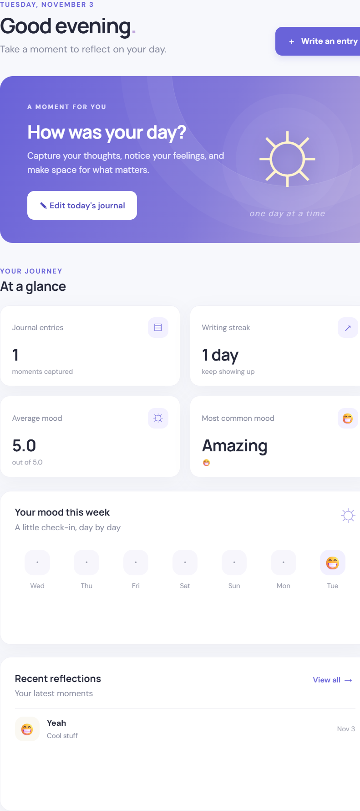

# Daylight — Daily Journal with Mood Tracker

Daylight is a calm, responsive journaling app for recording a daily entry, tracking a mood, and revisiting personal reflections. It runs in the browser with no server, framework, or build step.

## Home screen



## Features

- Dashboard with entry count, writing streak, average and most common mood, the latest seven days, and recent entries.
- Journal creation and editing for any past, present, or future date, with one entry per calendar day.
- Ten selectable moods, optional guided reflections, and character count.
- Search and combined date, month, mood, and sort filters.
- Calendar with entry and mood indicators, plus direct links into entries.
- Detail view, edit, delete confirmation, and empty states.
- JSON export and validated JSON import (matching dates are updated).
- All data remains in browser Local Storage; no backend or account is required.
- Responsive layouts, keyboard focus support, and safe display of user-entered text.

## Technology

- HTML5, CSS3, and vanilla JavaScript (ES6+).
- Browser Local Storage for persistence.
- Google Fonts (DM Sans and Manrope); the app otherwise has no runtime package dependencies.

## Folder structure

```text
.
├── index.html
├── css/
│   ├── styles.css
│   ├── components.css
│   └── responsive.css
├── js/
│   ├── app.js
│   ├── navigation.js
│   ├── storage.js
│   ├── journal.js
│   ├── mood.js
│   ├── dashboard.js
│   ├── calendar.js
│   └── utils.js
└── assets/
    ├── daylight-home.png
    └── icons/
        └── daylight.svg
```

## Run locally

Open `index.html` in a modern browser. No installation, build, backend, or local web server is required. Internet access is only needed to load the optional Google Fonts; system fonts are used as fallback.

## Local Storage

Entries are stored under the `dailyJournalEntries` key as a JSON array. Each entry contains an ID, calendar date, title, mood and score, journal content, reflection answers, and creation/update timestamps. The app preserves one entry per date and keeps its original creation timestamp when edited. Browser storage is specific to the browser profile and device; clearing browser site data also deletes the journal.

## Export and import

Open **Data & settings** to download a JSON backup or import a previous backup. The app checks the complete imported list before writing it. A malformed file is rejected without changing existing entries; entries with dates that already exist are replaced after confirmation. Consider exporting regularly if you want a portable backup.

# 🎯📗
## Prompt used:


# Project: Daily Journal with Mood Tracker

## Role
Act as a senior frontend developer and UI/UX designer. Build a complete, polished, modern **Daily Journal with Mood Tracker** web application using vanilla HTML5, CSS3, and JavaScript (ES6+).

The application must be fully functional, responsive, and use browser Local Storage as its database. Do not use a backend, server, database service, or frontend framework.

The result should feel like a professional, production-quality journaling application, not a basic HTML form or tutorial project.

---

# 1. Technology Stack

Use the following technologies:

- HTML5 for application structure.
- CSS3 for styling, layouts, animations, and responsive design.
- Vanilla JavaScript (ES6+) for all application logic.
- Browser Local Storage for persistent data storage.
- Lucide Icons (or another lightweight icon library) for modern icons.
- Google Fonts, preferably Inter or Manrope.
- CSS Grid and Flexbox for layouts.

Important:
- No React, Angular, Vue, or other frontend frameworks.
- No backend or API dependencies.
- No build tools required.
- The application must run locally by opening index.html.
- Organize JavaScript into reusable modules where practical.

---

# 2. Project Folder Structure

Create a clean and maintainable folder structure:
```text
/ (current workspace: /DailyPlan)
│
├── index.html
│
├── css/
│   ├── styles.css
│   ├── components.css
│   └── responsive.css
│
├── js/
│   ├── app.js
│   ├── navigation.js
│   ├── storage.js
│   ├── journal.js
│   ├── mood.js
│   ├── dashboard.js
│   ├── calendar.js
│   └── utils.js
│
├── assets/
│   └── icons/
│
└── README.md
```
Keep the code modular, readable, and well documented.

---

# 3. Design & User Experience

## Design inspiration

Use the visual design language of:
- Notion
- Google Keep
- Modern personal journaling applications
- Minimalist productivity dashboards

## Overall visual direction

Create a clean, elegant, calming, and distraction-free interface.

Design characteristics:
- Light background with subtle grey tones.
- White cards with soft shadows.
- Rounded corners (10–16px).
- Generous whitespace.
- Modern typography.
- Subtle borders and separators.
- Consistent spacing.
- Minimalist icons.
- Smooth hover effects and transitions.
- Restrained accent colors.

Suggested color palette:

- Primary: #6366F1 (Indigo)
- Secondary: #8B5CF6 (Purple)
- Background: #F8FAFC
- Surface: #FFFFFF
- Main text: #1E293B
- Secondary text: #64748B
- Border: #E2E8F0
- Positive mood: #22C55E
- Neutral mood: #F59E0B
- Negative mood: #EF4444

Use CSS variables for all design tokens.

## Layout

Desktop-first design:

- Fixed or sticky sidebar navigation on the left.
- Main content area on the right.
- Maximum content width for comfortable reading.
- Responsive card-based dashboard.
- Mobile navigation should transform into a compact menu or bottom navigation.

The interface must work smoothly on desktop, tablet, and mobile.

---

# 4. Application Pages

Build three main pages with client-side navigation. Switching pages should not reload the browser.

## PAGE 1: HOME / DASHBOARD

Purpose: Give the user a quick overview of their journaling activity and mood.

### Header

Display:
- Greeting: "Good evening!" (adjust according to local time).
- Current date.
- Short motivational subtitle, e.g. "Take a moment to reflect on your day."

### Primary action

Create a prominent card:

**How was your day?**

Subtitle: "Capture your thoughts and feelings."

Button: "+ Add Today's Journal"

Clicking this button should open the Add New Journal page with today's date preselected.

If today's journal already exists, change the button to "Edit Today's Journal" and open the existing entry.

### Statistics section

Display four attractive statistics cards:

1. Total Journal Entries
   - Number of saved journal entries.

2. Current Writing Streak
   - Consecutive days with journal entries.

3. Average Mood
   - Calculate the average mood based on recorded mood scores.

4. Most Common Mood
   - Display the mood selected most frequently.

All statistics must be calculated dynamically from Local Storage.

### Mood Overview

Display a visual mood overview for the last 7 days.

Use a simple chart or visual representation showing the mood for each day.

Each day should display:
- Day/date.
- Mood icon.
- Mood label.

Use colors to distinguish different moods.

### Recent Journal Entries

Show the last 3–5 journal entries.

Each card should contain:
- Date.
- Mood icon and label.
- Journal title.
- Short text preview.
- Read More action.

Clicking an entry opens the corresponding journal detail or edit view.

Provide a link to "View All Journals".

---

## PAGE 2: MY JOURNAL

Purpose: Browse, search, filter, and manage previous journal entries.

### Header

Title: "My Journal"

Subtitle: "Your thoughts, memories, and reflections."

### Search and filters

Include:

- Search input to search journal titles and content.
- Date filter.
- Month/year filter.
- Mood filter.
- Sort options:
  - Newest first.
  - Oldest first.

Filters should work together.

### Journal display

Display journal entries as modern cards or a clean timeline.

Each journal card should contain:

- Journal date.
- Weekday.
- Journal title.
- Mood icon.
- Mood label.
- Short journal preview.
- Created/updated information.

Actions:
- View journal.
- Edit journal.
- Delete journal.

Deleting an entry must display a confirmation dialog.

### Empty state

If there are no journal entries, display an attractive empty state:

"No journal entries yet."

"Every day is a new opportunity to reflect. Start writing your first journal entry."

Button: "Create Your First Journal"

---

## PAGE 3: ADD NEW JOURNAL

Purpose: Allow the user to create or edit a journal entry for any date.

This is one of the most important parts of the application.

### Important date behavior

By default, today's date must be selected.

However, the user must be able to select ANY date using a date picker.

The user can create journal entries for:
- Today.
- Yesterday.
- Any previous date.
- Any future date.

Do not restrict journal creation to today's date.

When the user selects a date that already has an entry, load that entry automatically into the form for editing.

When the user selects a date without an existing entry, show a blank journal form.

There must only be one journal entry per calendar date. Saving an entry for an existing date should update that entry rather than create a duplicate.

### Journal form

Fields:

**1. Journal Date**
- HTML date input.
- Default value: today's date.
- Editable by the user.

**2. Journal Title**
- Text input.
- Placeholder: "Give your day a title..."
- Example: "A productive day at work".

**3. How are you feeling today?**

Create an interactive mood selector using large emoji buttons or attractive selectable cards.

Provide the following mood options:

| Mood | Emoji | Score |
|---|---|---|
| Amazing | 😁 | 5 |
| Happy | 😊 | 4 |
| Good | 🙂 | 3 |
| Neutral | 😐 | 2 |
| Sad | 😔 | 1 |
| Anxious | 😰 | 1 |
| Stressed | 😫 | 1 |
| Angry | 😡 | 1 |
| Tired | 😴 | 2 |
| Grateful | 🥰 | 5 |

Requirements:
- Only one primary mood can be selected.
- Highlight the selected mood visually.
- Show a smooth selection animation.
- Save both mood name and score.
- Allow changing the mood before saving.

**4. Journal Content**

Create a comfortable writing area using a large textarea.

Placeholder:

"What happened today? What are you thinking about? Write freely..."

Requirements:
- Comfortable line height.
- Large writing area.
- Auto-expand textarea where practical.
- Character count.
- Support multiline text.
- Preserve line breaks when displaying saved entries.

**5. Additional Reflection (Optional)**

Include optional reflection prompts:

- What went well today?
- What could have been better?
- What am I grateful for today?
- What did I learn today?

These can be optional text fields or collapsible sections.

### Form actions

- Save Journal.
- Cancel.
- Clear Form (with confirmation).

After successfully saving:
- Persist data in Local Storage.
- Display a success notification.
- Navigate to My Journal or Home.
- Update all dashboard statistics immediately.

If the user tries to leave with unsaved changes, show a confirmation dialog.

---

# 5. Local Storage Database

Implement a dedicated storage.js module.

Use a consistent Local Storage key:

dailyJournalEntries

Example data structure:
```text
[
  {
    "id": "unique-id",
    "date": "2026-11-03",
    "title": "A productive day",
    "mood": {
      "name": "Happy",
      "emoji": "😊",
      "score": 4
    },
    "content": "Today was a good day...",
    "reflections": {
      "wentWell": "Completed an important project",
      "couldImprove": "Better time management",
      "gratitude": "Family and friends",
      "learned": "Learned something new"
    },
    "createdAt": "ISO timestamp",
    "updatedAt": "ISO timestamp"
  }
]
```
Implement these storage functions:

- getAllEntries()
- getEntryById(id)
- getEntryByDate(date)
- saveEntry(entry)
- updateEntry(id, updatedEntry)
- deleteEntry(id)
- clearAllEntries()
- getEntriesByMonth(year, month)

Requirements:
- Generate unique IDs.
- Handle missing or invalid Local Storage data gracefully.
- Avoid duplicate entries for the same date.
- Preserve createdAt when editing.
- Update updatedAt whenever an entry is modified.
- Never lose existing entries when saving a new entry.

---

# 6. Additional Functionality

Implement the following features:

### Calendar integration

Create a simple calendar view or date selector that allows the user to:
- Navigate between months.
- See which dates have journal entries.
- See a small mood indicator on dates with entries.
- Click a date to open its journal.

### Journal detail view

Allow users to open a journal entry in a comfortable reading layout.

Display:
- Date.
- Title.
- Mood.
- Full journal content.
- Reflection answers.
- Edit and Delete actions.

### Notifications

Create elegant toast notifications for:
- Journal saved successfully.
- Journal updated successfully.
- Journal deleted successfully.
- Validation errors.

### Data management

Add a small settings or utility section with:

- Export all journal entries as JSON.
- Import journal entries from JSON.
- Clear all journal data (with strong confirmation).

Import should validate the file structure before modifying existing data.

---

# 7. JavaScript Architecture

Keep application logic separated into modules.

Responsibilities:

**app.js**
- Application initialization.
- Main event listeners.
- Navigation initialization.

**navigation.js**
- Sidebar navigation.
- Page switching.
- Active navigation state.

**storage.js**
- All Local Storage operations.
- Data validation.
- CRUD operations.

**journal.js**
- Journal creation.
- Journal editing.
- Journal detail rendering.
- Journal deletion.
- Search and filtering.

**mood.js**
- Mood configuration.
- Mood selection.
- Mood statistics.

**dashboard.js**
- Dashboard rendering.
- Statistics calculation.
- Recent entries.
- Mood overview.

**calendar.js**
- Calendar generation.
- Month navigation.
- Entry indicators.

**utils.js**
- Date formatting.
- Unique ID generation.
- Toast notifications.
- Confirmation dialogs.
- Shared helper functions.

Avoid duplicated logic. Use reusable functions and event delegation where appropriate.

---

# 8. Responsive Design

Desktop (1200px and above):
- Full sidebar.
- Multi-column dashboard cards.
- Comfortable journal reading width.

Tablet (768px–1199px):
- Compact sidebar.
- Adjusted grid layouts.
- Responsive spacing.

Mobile (below 768px):
- Collapsible sidebar or bottom navigation.
- Single-column cards.
- Full-width forms.
- Touch-friendly buttons.
- Responsive date picker.
- No horizontal scrolling.
- Comfortable typography.

Test the design at:
- 1440px desktop.
- 1024px tablet.
- 768px small tablet.
- 390px mobile.
- 360px small mobile.

---

# 9. Quality Requirements

The application must:

- Be fully functional, not just a static mockup.
- Have no JavaScript console errors.
- Have no broken navigation.
- Work without a backend.
- Persist entries after refreshing the page.
- Handle empty states correctly.
- Validate required fields.
- Prevent duplicate entries for the same date.
- Support editing and deleting entries.
- Update dashboard statistics dynamically.
- Handle special characters and multiline text safely.
- Escape user-generated content to prevent HTML injection.
- Use semantic HTML and accessible labels.
- Provide visible keyboard focus states.
- Support keyboard navigation.
- Use consistent design patterns across all pages.

---

# 10. Deliverables

Create all required files in the project folder.

Also create a README.md containing:

- Project description.
- Features.
- Technology stack.
- Folder structure.
- How to run the application.
- How Local Storage works.
- How to export and import data.

Do not leave placeholder functions or TODO comments for core functionality.

---

# 11. Development Instructions for GitHub Copilot

Work in the following sequence:

**Phase 1: Project setup**
- Create the folder structure.
- Build the main HTML layout.
- Define CSS variables and the design system.
- Implement responsive navigation.

**Phase 2: Core functionality**
- Implement Local Storage.
- Implement journal creation and editing.
- Implement mood selection.
- Implement date selection and duplicate-date handling.

**Phase 3: Application pages**
- Build Home dashboard.
- Build My Journal.
- Build Add New Journal.
- Build journal detail view.

**Phase 4: Additional features**
- Implement search and filtering.
- Implement calendar.
- Implement statistics.
- Implement JSON import/export.
- Implement notifications and confirmation dialogs.

**Phase 5: Testing and refinement**
- Test all CRUD operations.
- Test persistence after browser refresh.
- Test date selection for past and future dates.
- Test duplicate-date handling.
- Test responsive layouts.
- Fix all errors.
- Refine visual consistency.

IMPORTANT – PROJECT LOCATION

The current VS Code workspace is already /DailyPlan.

Use the existing workspace root (/DailyPlan) as the project root.

Do NOT create another daily-journal folder.

Do NOT create another /root folder.

Place index.html directly in the current workspace root.

Create the css, js, and assets folders directly inside the workspace root.

All relative file paths and imports must work from this root.

The application must be created directly inside the existing /DailyPlan workspace.

IMPORTANT: Do not stop after creating the HTML and CSS. Implement the complete JavaScript functionality.

Before finishing, verify that every requested feature works.

The final result should look and feel like a polished, modern personal journaling product that someone would genuinely enjoy using every day.