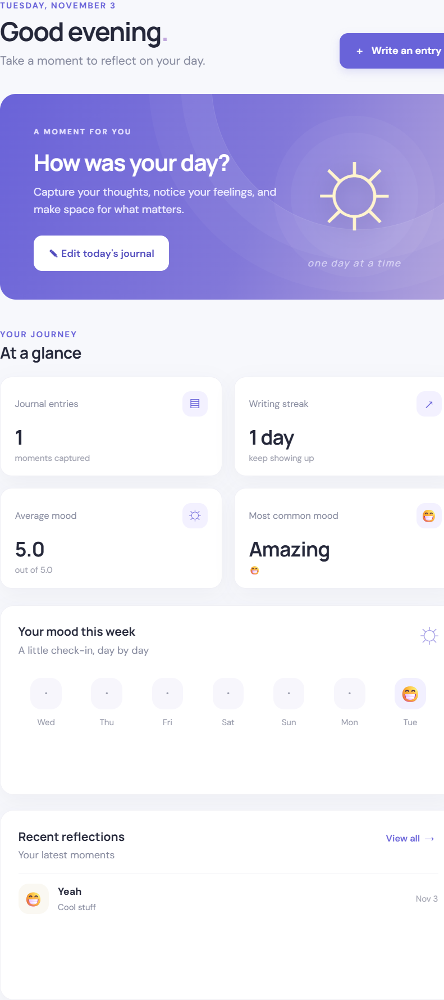

# 🌙 Daylight — Daily Journal with Mood Tracker

A calm, responsive journaling application for recording daily thoughts, tracking mood, and revisiting personal reflections. Runs entirely in your browser with no server, backend, or account required. Your data is yours—stored locally and never sent anywhere.



---

## ✨ Features

### Journal Management
- **Create & Edit** — Write journal entries for any past, present, or future date
- **One Entry Per Day** — One thoughtful entry per calendar day, preventing duplicates
- **Rich Content** — Capture titles, mood, detailed thoughts, and guided reflections
- **Character Counter** — Track entry length as you write

### Mood Tracking
- **Ten Moods** — Select from 10 distinct emotions: Ecstatic, Happy, Content, Calm, Neutral, Restless, Anxious, Sad, Angry, Devastated
- **Mood Statistics** — View average mood, most common emotion, and weekly distribution
- **Visual Indicators** — Emoji and color-coded mood representation throughout the app

### Dashboard Overview
- **Entry Count** — Total journal entries written
- **Writing Streak** — Consecutive days with entries
- **Mood Analytics** — Average mood score and most frequent emotion
- **Last 7 Days** — Quick visual summary of recent activity
- **Recent Entries** — Quick access to your latest thoughts

### Calendar View
- **Month Overview** — See your entire month at a glance
- **Entry Indicators** — Visual markers for dates with entries
- **Mood Display** — Emoji indicators showing mood for each date
- **Navigation** — Easy month-to-month browsing
- **Direct Entry Creation** — Click any date to create or edit entries

### Search & Filtering
- **Full-Text Search** — Find entries by keywords in title, content, or reflections
- **Filter by Mood** — Show only entries for a specific emotion
- **Filter by Date** — Search within date ranges or specific months
- **Flexible Sorting** — Newest first, oldest first, best mood, worst mood
- **Combined Filters** — Use multiple filters simultaneously for precise results

### Data Management
- **Export Data** — Download complete journal as JSON backup
- **Import Data** — Restore from backup or merge data from other devices
- **Conflict Resolution** — Smart handling of duplicate dates during import
- **No Data Loss** — Complete validation before any import
- **Responsive Confirmation** — Clear prompts before destructive actions

### Design & Accessibility
- **Responsive Layout** — Works beautifully on desktop, tablet, and mobile
- **Keyboard Navigation** — Full keyboard accessibility and focus management
- **Touch-Friendly** — Optimized for touch devices and small screens
- **Safe Text Display** — All user-entered text is properly sanitized
- **Smooth Animations** — Pleasant transitions and interactions
- **Offline-First** — Works without internet after initial load

---

## 🏗️ Technology Stack

### Frontend
- **HTML5** — Semantic, accessible markup
- **CSS3** — Modern styling with Grid, Flexbox, and animations
- **JavaScript (ES6+)** — Vanilla, framework-free code organized into modules
- **Google Fonts** — Professional typography (DM Sans, Manrope) with system fallbacks

### Storage & APIs
- **Browser Local Storage** — Client-side persistence, 5-10MB per browser
- **JSON** — Human-readable data import/export format
- **Fetch API** — Optional external resources (fonts only)

### Zero Dependencies
- ✅ No npm packages
- ✅ No build tools (webpack, babel, etc.)
- ✅ No frontend framework (React, Vue, Angular)
- ✅ No backend server, API, or database
- ✅ No authentication or account system
- ✅ Runs by opening `index.html` in a browser

---

## 📁 Project Folder Structure

```
DailyPlan/
├── index.html                      # Main application entry point
├── README.md                       # This file
├── LICENSE                         # MIT License
├── CHANGELOG.md                    # Version history
├── CONTRIBUTING.md                 # Contribution guidelines
├── CODE_OF_CONDUCT.md             # Community guidelines
├── SECURITY.md                     # Security policy and considerations
├── SUPPORT.md                      # How to get help
├── .gitignore                      # Git ignore rules
├── .editorconfig                   # Editor configuration
├── .gitattributes                  # Git attributes for text files
├── .nojekyll                       # Disable Jekyll for GitHub Pages
│
├── css/
│   ├── styles.css                 # Core styles and CSS variables
│   ├── components.css             # Component-specific styling
│   └── responsive.css             # Media queries and responsive design
│
├── js/
│   ├── app.js                     # Application initialization
│   ├── navigation.js              # Client-side routing and view switching
│   ├── storage.js                 # Local Storage operations
│   ├── journal.js                 # Journal CRUD operations
│   ├── mood.js                    # Mood tracking and statistics
│   ├── dashboard.js               # Dashboard view and calculations
│   ├── calendar.js                # Calendar view logic
│   └── utils.js                   # Shared utility functions
│
├── assets/
│   ├── daylight-home.png          # Dashboard screenshot
│   └── icons/
│       └── daylight.svg           # Application icon
│
├── docs/
│   ├── ARCHITECTURE.md            # Technical architecture and module overview
│   ├── DATA_MODEL.md              # Data structure and schema documentation
│   └── USER_GUIDE.md              # Complete user documentation
│
└── .github/
    ├── CONTRIBUTING.md             # Link to main contributing guide
    ├── ISSUE_TEMPLATE/
    │   ├── bug_report.md           # Bug report template
    │   └── feature_request.md      # Feature request template
    ├── PULL_REQUEST_TEMPLATE.md    # Pull request template
    └── workflows/
        └── validate.yml            # GitHub Actions validation workflow
```

---

## 🚀 Installation & Setup

### Quick Start

1. **Clone or Download** the repository
   ```bash
   git clone https://github.com/lupoharry/DailyPlan.git
   cd DailyPlan
   ```

2. **Open in Browser** — Simply open `index.html` in your web browser
   - No installation required
   - No dependencies to install
   - No build step needed

3. **Start Journaling** — Create your first entry!

### Running Locally with Live Server (Recommended)

Using VS Code Live Server extension for better development experience:

1. **Install Live Server** extension in VS Code (if not already installed)

2. **Open project** in VS Code
   ```bash
   code .
   ```

3. **Start Live Server**
   - Right-click `index.html`
   - Select "Open with Live Server"
   - Browser opens to `http://localhost:5500`

4. **Changes auto-reload** as you work

### Browser Requirements

- Chrome/Chromium (v90+)
- Firefox (v88+)
- Safari (v14+)
- Edge (v90+)
- Any modern browser with ES6, LocalStorage, and Fetch API support

---

## 📖 How to Use

### Creating Your First Entry

1. Open the application
2. Click **"Create Entry"** on the dashboard
3. Fill in:
   - **Title** — Brief entry headline
   - **Mood** — Select your mood (1 of 10)
   - **Content** — Write your thoughts
   - **Reflections** (optional) — Answer guided questions
4. Click **"Save Entry"**

### Editing Previous Entries

1. Find your entry via:
   - Journal list view
   - Dashboard recent entries
   - Calendar date
   - Search results
2. Click entry to view details
3. Click **"Edit"** button
4. Make changes and click **"Save Changes"**

### Tracking Your Mood

- Select a mood when creating or editing entries
- View mood statistics on dashboard
- Filter by mood in search view
- See mood distribution across different time periods

### Using the Calendar

1. Click **"Calendar"** in navigation
2. Browse months with previous/next buttons
3. Click on a date to:
   - View existing entry
   - Create new entry for that date
4. See mood emoji for each date with an entry

### Searching Your Journal

1. Click **"Search"** in navigation
2. Enter search terms to find entries by:
   - Text content (title, body, reflections)
   - Mood (Happy, Anxious, etc.)
   - Date range
   - Specific month
3. Sort results (newest, oldest, best mood, worst mood)
4. Click any result to view full entry

### Exporting Your Data

1. Click **"Data & Settings"** or **"Settings"**
2. Click **"Export Data"** button
3. A JSON file downloads to your computer
4. Save to cloud storage or external drive for backup

### Importing Data

1. Click **"Data & Settings"** or **"Settings"**
2. Click **"Import Data"** button
3. Select a previously exported JSON file
4. Review conflicts (if any)
5. Confirm import
6. Data merges with existing entries

---

## 💾 Local Storage Explanation

### What is Local Storage?

Local Storage is a browser feature that stores data locally on your device (not on a server).

### Where is My Data?

- **Stored locally** on your computer/device in your browser profile
- **Not sent to any server** — completely private
- **Specific to browser** — Safari data separate from Chrome, etc.
- **Specific to device** — phone data separate from computer
- **Survives browser restart** — persists until you manually delete it

### How Much Can I Store?

- Most browsers allow **5-10MB per website**
- Average entry is ~1KB
- That's space for **5,000+ entries**
- At 1 entry/day = ~13 years of journaling

### Storage Limitations

- **Unencrypted** — Data is plaintext (though browser handles securely)
- **No sync** — Doesn't sync across devices or browsers
- **Can be cleared** — Clearing browser data deletes Local Storage
- **Private windows** — Incognito/private browsing doesn't persist data

### Clearing Your Data

⚠️ This permanently deletes all journal entries!

**In Developer Tools:**
1. Press F12 (Developer Tools)
2. Go to Application → Local Storage
3. Find the Daylight entry
4. Delete the `dailyJournalEntries` key

**Or clear browser data:**
1. Browser settings → Clear browsing data
2. Select "Cookies and other site data"
3. Select timeframe "All time"
4. Click Clear

### Privacy & Security

✅ **What's Secure:**
- Data never leaves your device
- No accounts or logins
- No tracking or analytics
- No third-party access
- You have complete control

⚠️ **What to Know:**
- Device with access = data access
- Malware could potentially access Local Storage
- Browser extensions could theoretically access data
- Not encrypted at rest

🔒 **How to Protect:**
- Use full-disk encryption on your device
- Keep device secure and password-protected
- Export backups to secure external storage
- Review browser extensions for trustworthiness
- Regularly back up important data

---

## 💾 Data Backup & Restore

### Why Backup?

- Protect against data loss
- Safeguard against browser data clearing
- Move data between devices
- Archive years of journaling
- Security against device failure

### Regular Backup Strategy

**Recommended Frequency:**
- ✅ Weekly — Export to external drive
- ✅ Monthly — Save to cloud storage
- ✅ Before major events — Before clearing browser data
- ✅ Seasonally — Archive by season/year

**Storage Locations:**
- Computer/external drive
- Cloud storage (Google Drive, OneDrive, Dropbox)
- USB drive or external SSD
- Private encrypted storage
- Email to yourself
- Password manager backup

### Export Process

1. Go to **Settings** → **Data Management**
2. Click **"Export All Data"** button
3. Browser prompts to download file
4. File is named: `daylight-backup-YYYY-MM-DD.json`
5. Move file to backup location

### Import Process

1. Go to **Settings** → **Data Management**
2. Click **"Import Data"** button
3. Select JSON backup file
4. App shows conflicts (if any)
5. Choose "Replace", "Keep", or "Cancel"
6. Click "Import"
7. Data is restored

### Merging Data from Multiple Devices

**Scenario:** You journal on both laptop and phone

1. **Export from Device A** — Save backup to cloud
2. **Import on Device B** — Open backup file
3. **Choose "Replace"** for dates that exist on both
4. **Now both devices have all entries**

### Backup File Format

Export files are standard JSON:

```json
[
  {
    "id": "550e8400-e29b-41d4-a716-446655440000",
    "date": "2026-11-05",
    "title": "Today's Thoughts",
    "mood": "happy",
    "moodScore": 8,
    "content": "Entry text here...",
    "reflections": ["Answer 1", "Answer 2", "Answer 3"],
    "createdAt": "2026-11-05T10:30:00Z",
    "updatedAt": "2026-11-05T10:30:00Z"
  }
]
```

- **Human-readable** — Open in any text editor
- **No encryption** — Store securely separate
- **No corruption risk** — Validated before import
- **Portable** — Works across browsers and devices

---

## 🌐 Browser Compatibility

| Browser | Desktop | Mobile | Minimum Version |
|---------|---------|--------|-----------------|
| Chrome | ✅ | ✅ | v90+ |
| Firefox | ✅ | ✅ | v88+ |
| Safari | ✅ | ✅ | v14+ |
| Edge | ✅ | ✅ | v90+ |
| Opera | ✅ | ✅ | v76+ |
| Samsung Internet | ⚠️ | ✅ | v14+ |

**Required Features:**
- ES6 JavaScript support
- CSS Grid and Flexbox
- Local Storage API
- Fetch API
- JSON object

**Mobile Considerations:**
- Touch-optimized interface
- Works in mobile browsers
- Can add to home screen as web app
- Responsive design for all screen sizes

---

## 🔐 Privacy & Security Information

### No Data Collection

✅ Daylight **does not:**
- Collect personal information
- Track your behavior
- Send data to servers
- Use analytics or cookies
- Require accounts or login
- Connect to internet (after initial load)

✅ Your data is:
- Stored only on your device
- Never transmitted
- Under your complete control
- Private by default

### Local Storage Security

**Strengths:**
- Browser-managed storage
- Isolated per origin
- Protected by browser sandbox
- Cleared only on user action

**Limitations:**
- Plaintext storage (unencrypted)
- No authentication required to access (on that device)
- Specific to device and browser
- Visible to browser extensions
- Cleared when browser data cleared

### Responsible Use

- Use on **trusted, personal devices** only
- Don't share browser sessions
- Protect your device with strong passwords
- Use full-disk encryption
- Review browser extensions
- Export backups regularly

### Third-Party Services

**Google Fonts:**
- Optional external font loading
- May collect usage statistics
- See [Google Privacy Policy](https://policies.google.com/privacy)
- App uses system fonts as fallback (works offline)

**GitHub (where code is hosted):**
- View [GitHub Privacy Policy](https://docs.github.com/en/site-policy/privacy-policies/github-privacy-statement)

---

## 🗺️ Roadmap

### Version 1.0.0 (Current)
- ✅ Core journaling functionality
- ✅ 10 mood tracking options
- ✅ Local Storage persistence
- ✅ Calendar view
- ✅ Search and filtering
- ✅ Export/import data
- ✅ Responsive design
- ✅ GitHub documentation

### Future Enhancements (Proposed)

**Version 1.1.0:**
- Tags for categorizing entries
- Multiple emoji/visual options
- Advanced statistics (mood trends, writing patterns)
- Customizable mood list
- Dark mode theme
- Entry templates

**Version 1.2.0:**
- Full-text search improvements
- Entry pinning/favorites
- Word count statistics
- Monthly summaries
- Reading time estimates
- Print-friendly format

**Version 2.0.0 (If Expanded):**
- Optional sync across devices (via encryption)
- Sharing entries (read-only with encryption)
- Mobile app (Electron desktop or React Native)
- Backend support (optional, privacy-first)
- Attachment support
- Voice entry transcription

### What We Won't Add

🚫 Never:
- Advertisements or tracking
- Paid features (always free)
- Forced account creation
- Cloud sync without opt-in
- Feature bloat — keeping it simple
- Unnecessary dependencies

---

## 📄 License

This project is licensed under the **MIT License**. See [LICENSE](./LICENSE) file for complete details.

**MIT License Summary:**
- ✅ Free to use, modify, and distribute
- ✅ Suitable for personal and commercial use
- ✅ Include original license in distributions
- ✅ No warranty provided

---

## 🤝 Contributing

We welcome contributions! Before contributing, please read:

1. **[Contributing Guide](./CONTRIBUTING.md)** — Development setup and conventions
2. **[Code of Conduct](./CODE_OF_CONDUCT.md)** — Community guidelines

### Quick Start for Contributors

```bash
# Clone the repository
git clone https://github.com/lupoharry/DailyPlan.git
cd DailyPlan

# Open in VS Code with Live Server
code .

# Right-click index.html → "Open with Live Server"
```

### Areas for Contribution

- 🐛 **Bug fixes** — Report and fix issues
- ✨ **Features** — New functionality (within scope)
- 📚 **Documentation** — Improve guides and comments
- 🎨 **Design** — UI/UX improvements
- 🧪 **Testing** — Cross-browser and device testing
- ♿ **Accessibility** — WCAG compliance improvements

### Development Guidelines

- **Branch naming** — `feature/`, `bugfix/`, `docs/`, etc.
- **Commits** — Follow conventional commit format
- **Code style** — See `.editorconfig` and CONTRIBUTING.md
- **Testing** — Manual testing required (see checklist in CONTRIBUTING.md)
- **Documentation** — Update docs for new features

---

## 📖 Documentation

### For Users
- **[User Guide](./docs/USER_GUIDE.md)** — How to use every feature
- **[SUPPORT.md](./SUPPORT.md)** — Getting help, FAQs, troubleshooting

### For Developers
- **[Architecture](./docs/ARCHITECTURE.md)** — Technical design and modules
- **[Data Model](./docs/DATA_MODEL.md)** — Data structure and schema
- **[Contributing Guide](./CONTRIBUTING.md)** — Development guidelines

### For Maintainers
- **[Security Policy](./SECURITY.md)** — Security considerations and reporting
- **[Code of Conduct](./CODE_OF_CONDUCT.md)** — Community standards
- **[Changelog](./CHANGELOG.md)** — Version history
- **[GitHub Actions](./github/workflows/validate.yml)** — CI/CD validation

---

## 🛠️ Technology Highlights

### Why Vanilla JavaScript?

- **No dependencies** — No npm packages to install/maintain
- **Fast loading** — No framework overhead
- **Better learning** — Direct browser API usage
- **Full control** — No abstraction layers
- **Offline-first** — Works without internet
- **Runs anywhere** — Just HTML, CSS, JavaScript

### Why Local Storage?

- **Simple** — Straightforward API, no configuration
- **Sufficient** — 5-10MB per browser is plenty for journal
- **No backend** — Eliminate server costs and complexity
- **Privacy** — Data never leaves device
- **Performance** — Fast reads/writes
- **Reliable** — Well-supported across browsers

### Why No Framework?

Daylight proves that modern web apps don't need React, Vue, or Angular:

- **Simpler codebase** — Easier to understand and maintain
- **Smaller bundle** — Instant loading
- **Direct DOM** — Predictable behavior
- **Learning tool** — Shows real browser APIs
- **Production-ready** — Fully featured without framework

---

## 🎯 Project Goals

Daylight aims to be:

✅ **Private** — Your data, your device
✅ **Simple** — One entry per day, uncomplicated
✅ **Beautiful** — Calm, modern, distraction-free
✅ **Reliable** — Works offline, no dependencies
✅ **Accessible** — Keyboard navigation, inclusive design
✅ **Maintainable** — Clear code, good documentation
✅ **Free** — Always free, always open source
✅ **Inspirational** — Helps users reflect and grow

---

## ❓ Frequently Asked Questions

**Q: Is my data safe?**
A: Your data stays on your device in Local Storage. It's never sent anywhere. However, Local Storage is unencrypted plaintext. Keep your device secure.

**Q: Can I sync across devices?**
A: Currently no. Export from one device and import on another. Future versions may add optional sync.

**Q: What if I clear my browser data?**
A: All Daylight entries are deleted. Always export regular backups!

**Q: Can I share entries with someone?**
A: You can export your journal and share the JSON file. They can import it into their Daylight.

**Q: What if you shut down the project?**
A: Your data is already on your device. Export it and it's yours forever. The code is open source.

**Q: Is there a mobile app?**
A: The web app works great on mobile. You can add it to your home screen. Native apps are a possible future enhancement.

**Q: Do you have a privacy policy?**
A: There's no data collection, so minimal privacy concerns. See [SECURITY.md](./SECURITY.md) for details.

**Q: Can I contribute?**
A: Yes! See [CONTRIBUTING.md](./CONTRIBUTING.md) for guidelines.

---

## 📞 Support & Feedback

**Getting Help:**
- Read [User Guide](./docs/USER_GUIDE.md) for feature usage
- Check [SUPPORT.md](./SUPPORT.md) for FAQs and troubleshooting
- Review [Architecture docs](./docs/ARCHITECTURE.md) for technical questions

**Report Issues:**
- [Open a bug report](https://github.com/lupoharry/DailyPlan/issues/new?template=bug_report.md)
- [Request a feature](https://github.com/lupoharry/DailyPlan/issues/new?template=feature_request.md)

**Security Concerns:**
- Email security contact (see [SECURITY.md](./SECURITY.md))
- Do not open public security issues

---

## 🙏 Acknowledgments

- Inspired by Notion, Google Keep, and modern journaling apps
- Icons and design patterns from contemporary web apps
- Built with accessibility and user privacy in mind
- Community feedback and contributions (coming soon!)

---

## 📊 Project Stats

- **Built with:** HTML5, CSS3, Vanilla JavaScript (ES6+)
- **Browser APIs:** Local Storage, Fetch, Date, JSON
- **Size:** ~50KB HTML/CSS/JS (production)
- **Performance:** Instant load, smooth 60fps interactions
- **Accessibility:** WCAG 2.1 Level AA target
- **Code:** Open source, MIT licensed
- **Maintenance:** Actively maintained

---

**Start journaling today! 🌙**

Open `index.html` in your browser and begin capturing your daily thoughts, moods, and reflections.

---

<div align="center">

Made with 💙 for mindfulness and self-reflection.

[GitHub](https://github.com/lupoharry/DailyPlan) • [Documentation](./docs/USER_GUIDE.md) • [License](./LICENSE)

</div>
